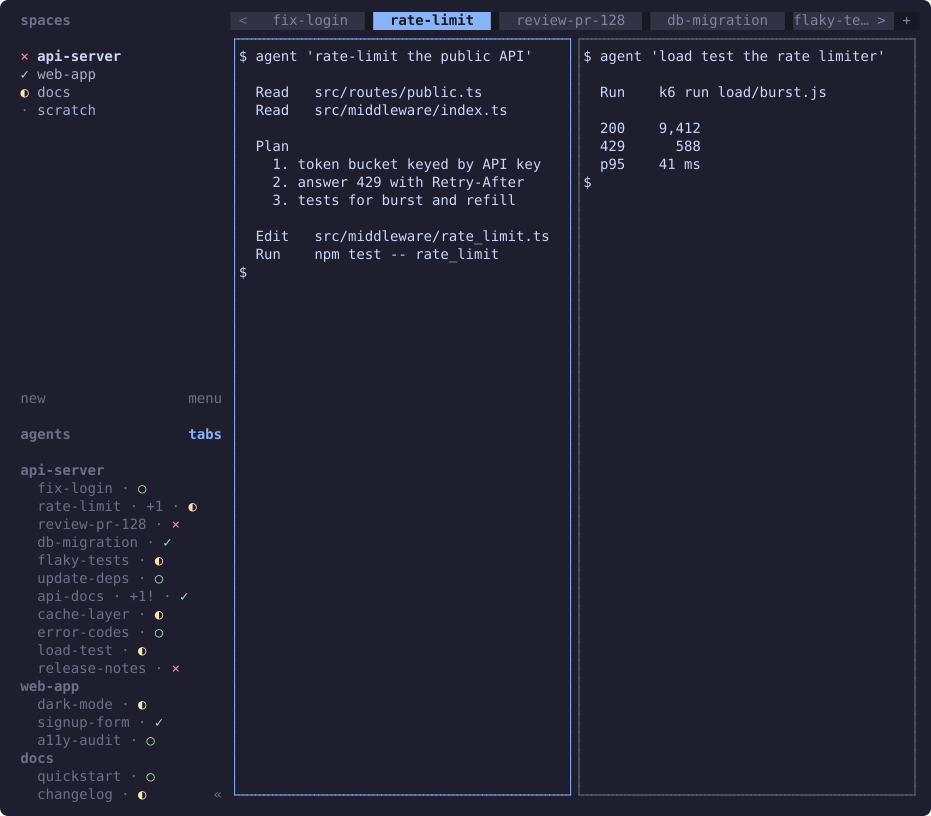

# herdr-tab-sidebar

[English](README.md) | 日本語

サイドバーの Agents パネルを縦型のタブ一覧に変える [Herdr](https://herdr.dev) プラグインです。エージェントがいるタブを 1 行ずつ表示し、ワークスペースごとの見出しの下にまとめます。



この画像は、`demo/run.py --svg` で生成した架空のセッションです。[デモ](docs/internals.ja.md#デモ)を参照してください。

- ワークスペースは Spaces パネルの順（自分で並べた順）、タブはタブバーの順に並びます。
- 複数のエージェントがいるタブも 1 行で表示されます。`+1` は個別の行を持たないエージェントの数です。末尾に `!` が付くのは、そのいずれかが blocked か done のときです。
- 行を選択すると、そのタブの代表ペインにフォーカスが移ります。

## 動作要件

- Herdr 0.9.1 以降。
- Python 3.9 以降。Herdr サーバーの PATH 上で `python3` として見つかる必要があります。
- macOS または Linux。Linux では、まだ何も手で試していません。

## インストール

```sh
herdr plugin install tyamanak/herdr-tab-sidebar
herdr plugin action invoke tyamanak.tab-sidebar.apply
```

`config.toml` が書き換わり、`[ui.sidebar.agents]` が追加されます。

もしすでに `[ui.sidebar.agents]` が定義されている場合は何も変更されません。自分の定義を削除するかコメントアウトしてから `apply` を実行する、もしくは[変更する内容](docs/config.ja.md#変更する内容)を参照してください。

## アンインストール

以下の手順を順に実行してください。

1. 本プラグインの解除

   ```sh
   herdr plugin action invoke tyamanak.tab-sidebar.release
   ```

2. 状態の確認

   ```sh
   herdr plugin action invoke tyamanak.tab-sidebar.status
   herdr plugin log list --plugin tyamanak.tab-sidebar
   ```

   最新の `status` のエントリーが `state: released` で終わっているのを確認して次へ進んでください。もし `released` にならない場合は、[解除が終わらないとき](docs/config.ja.md#解除が終わらないとき)を参照してください。

3. アンインストール

   ```sh
   herdr plugin uninstall tyamanak.tab-sidebar
   ```

プラグインの行を `config.toml` から手作業で取り除く場合は、[手作業で取り除く](docs/config.ja.md#手作業で取り除く)を参照してください。

## 制限

- シェルなど、エージェントのいないタブは一覧に表示されません。
- 複数のエージェントがいるタブでは、プラグインの適用中、次/前のエージェントへの移動でほかのエージェントにたどり着けません。
- 適用中は、Herdr 自身の Agents パネルの並び順と、Herdr の Agent ビューを、プラグインが置き換えます。ビューを設定する別のプラグインとの併用は試していません。

すべての制限は、[制限](docs/usage.ja.md#制限)を参照してください。

## ドキュメント

- [使い方](docs/usage.ja.md): 動作要件、確認、アクション、更新、制限。
- [設定](docs/config.ja.md): `apply` が書き込む内容と、元に戻す方法。
- [内部の仕組み](docs/internals.ja.md): 仕組み、テスト、デモ。

## ライセンス

MIT。[LICENSE](LICENSE) を参照してください。
